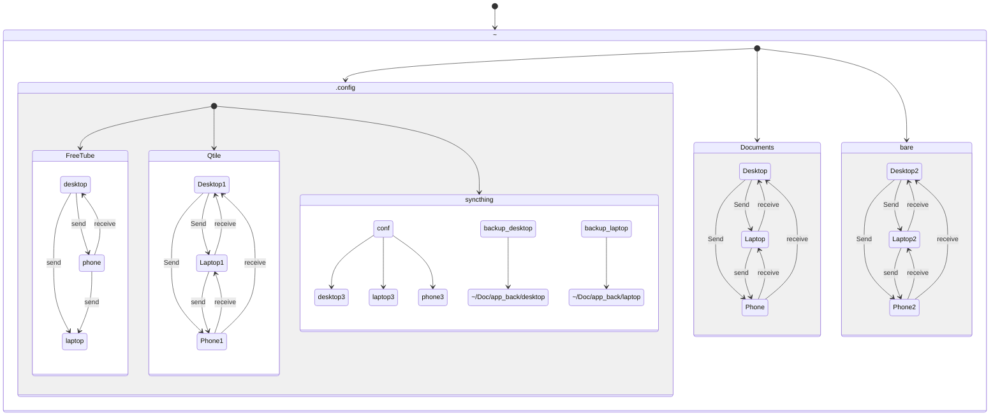

<!-- TOC -->

## Device Configurations

### Android

> [!NOTE]
> Folder path for Documents:
> /storage/emulated/0/Documents/app_backups

```txt
/global-repos

// Coding related
node_modules
.angular/cache
target/
*target/
build/
*build/
develop-eggs/
*.py[cod]
*$py.class
bower_components
.venv
__pycache__
.mypy_cache
.ruff_cache
.pytest_cache/
.hypothesis
eggs/
.eggs/
*.egg-info/
*.egg
dist/
*dist/
MANIFEST
packages/plugin-api/dist/**
packages/plugin-api/dist/**/*.*
/packages/plugin-api/src/**/*.js
/packages/plugin-api/src/**/*.js.map

// PyInstaller
*.manifest
*.spec
```

### Desktop

> [!NOTE]
> We don't ignore egg-info because out-of-sync problem.

```txt
// Coding related
node_modules
.angular/cache
target/
*target/
build/
*build/
develop-eggs/
*.py[cod]
*$py.class
bower_components
.venv
__pycache__
.mypy_cache
.ruff_cache
.pytest_cache/
.hypothesis
dist/
*dist/
MANIFEST
packages/plugin-api/dist/**
packages/plugin-api/dist/**/*.*
/packages/plugin-api/src/**/*.js
/packages/plugin-api/src/**/*.js.map

// PyInstaller
*.manifest
*.spec
```

## Connection Configurations

- .zshrc inside scripts/desktop/ I also use git to track and sync files I care about in my home dir. To avoid having to symlink from another place you can selectively include stuff you care about (that’s what I do in .gitignore, just with a slightly different syntax). e.g create the Syncthing folder at ~/ and put into .stignore:

!/.vimrc
!/.bashrc



## Other Informations

## Ignoring & Excluding Files

> [!NOTE]
> Ignore egg-info egg files from phone and keep it on desktop because it cause out-of-sync issue.
>
> Also egg-info is 4K don't worry about it to synced via another device...

> [!WARNING]
> For docs (DO NOT USE (?d) because it remove it all other folders that include those like test files etc.)

### How syncthing sync?

- It's send files and make them [temporary file](https://docs.syncthing.net/users/syncing.html#temporary-files) for if something goes wrong(last connection, conflict.).

### Override Changes button

- Override changes the other host from send only host(e.g who able to see this button.).

### Revert Local Changes

- Do not use this option if you are using send and receive, as it would revert the local changes and send them to other hosts. Therefore, you would lose your data if your other host is up-to-date.

## Security

> [!IMPORTANT] Knowing your device ID can expose your IP address, using global discovery.

### Protecting your Syncthing keys and identity

> [!INFO]
> [source](https://docs.syncthing.net/users/security.html#protecting-your-syncthing-keys-and-identity "Link to this heading")

Anyone who can access the Syncthing TLS keys and config file on your device can impersonate your device, connect to your peers, and then have access to your synced files. Here are some general principles to protect your files:

1. If a device of yours is lost, make sure to revoke its access from your other devices.
2. If you’re syncing confidential data on an encrypted disk to guard against device theft, put the Syncthing config folder on the same encrypted disk to avoid leaking keys and metadata. Or, use whole disk encryption.

- I think this would only work when you use Syncthing with relays and others, because if you do not allow a connection by firewall, they can't access even if you expose your IP address but need to be caution because we allow syncthing port from firewall, so hackers can show their connection as your configured laptop etc. Again, this mostly would be work if you set the syncthing globally discoverable.
- I am using local Syncthing by manually adding an IP address from my local IP address like 192.x.x.x.
- Firstly, they need to hack one of my machines to use Syncthing.
- If they hack one of my machine like desktop, they can probably access all of my other devices because of the Nix store world-readable; therefore, they can find out important things, etc., and they would be able to hack other machines too. This wouldn't be the Syncthing issue though.

### How to make syncthing local usage without any server connection?

1. Disable all relay, global/local discovery and set the listening address `tcp://:22000` (IPV4 and IPV6) or `tcp4://:22000` (IPV4).
2. Add device connection with their ip adress on advance section: `tcp4://192.168.1.39:22000` instead of dynamic.

## Applications usage cases

### Freetube

> [!DANGER]
> It's not working whatever I do... Just use "send" only from one desktop to others (receive from others only).

1. Firstly, I started syncing them via send & receive. I ignored cache files and some of the other files, but it wouldn't sync without the `local & session storage, storyboard,/shared_proto_db,` folders.
2. It's not syncing when you delete a playlist on your desktop. It syncs the playlist from your laptop again, but a workaround is to add a new video to some other playlist. When you do that, it's able to sync the deleted playlist. I'm guessing this is happening because of a sync conflict. I think when you delete one of the playlists, syncing makes a conflict with your laptop because there are differences in the playlists. But when you add a new video to another playlist, it probably sees that as something new on the desktop, and since there's no conflict with your laptop – because there is a new video on the desktop version – it gets the desktop one instead of making a conflict.

This only for mobile, caches needed for machine sync because it won't handle playlist etc.

```txt
// Ignore all and get only neeeded
**
!playlist.db
!profiles.db
!history.db
!settings.db
```

### Siyuan

- Internal/Android/data/org.b3log.siyuan/files
- Can't acces data file because of android permissions...
- Also siyuan corrupt when we use syncthing. (devs said)
  - That's why I use neovim with obsidian.nvim plugin now.

<!-- /TOC -->
